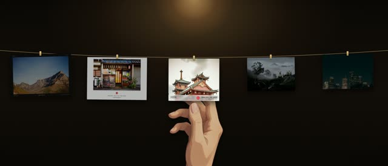
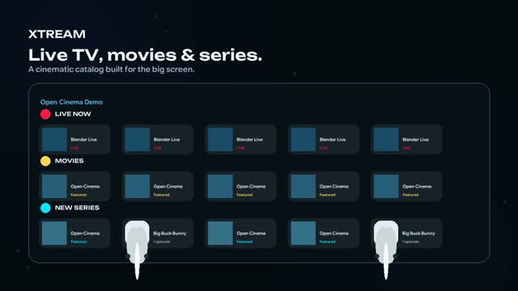
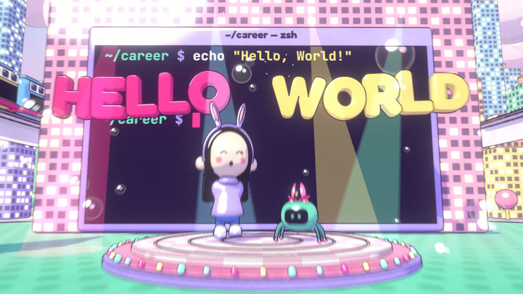
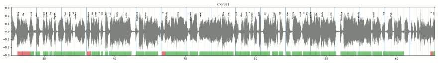
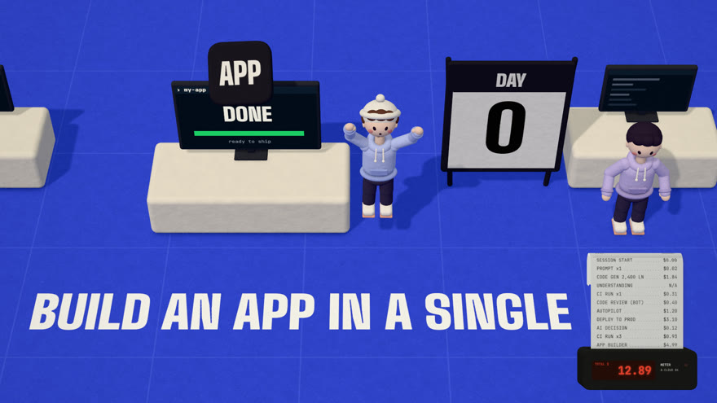

# claude-video-kit

Repo: https://github.com/IFA-AP-01/claude-video-kit

Portable Claude Code skills and working rules for video, motion films, store screenshots and marketing visuals. Clone it on any Mac, run `./install.sh`, and every project gets the same skills and lessons.

## Contents
| Path | What | Look |
|---|---|---|
| `user/CLAUDE.md` | cross-project working rules, imported into `~/.claude/CLAUDE.md` |  |
| `skills/video-playbook` | hub: working style, aesthetics, troubleshooting, pipeline, store specs, lessons, request/spec templates |  |
| `skills/app-motion-film` | films from real simulator recordings in a 3D iPhone Duo with kinetic type; scripts + film template |  |
| `skills/scenario-kinetic-film` | kinetic-type film engine: render, mix, finish, snap (see its PROVENANCE.md) |  |
| `skills/threejs-music-video` | deterministic three.js music videos, Chrome → ffmpeg |  |
| `skills/lyric-beat-analysis` | stems, word-level lyric alignment, beat grid |  |
| `skills/camera-motion`, `lyric-staging`, `toon-look` | camera moves on the beat, lyrics as objects, toon materials |  |
| `skills/paper-vox-short` | 9:16 paper-cutout explainer shorts with voice-over |  |
| `skills/cartoon-explainer` | 16:9 Infographics-Show-style cartoon explainers: SVG puppets with lip-sync, bubbles, stat pills, charts (HyperFrames + GSAP) |  |
| `skills/kurz-look` | Kurzgesagt / Star Birds-grade vivid semi-3D SVG look: style bible, kit.js, film template, examples |  |

## New machine
```bash
git clone https://github.com/IFA-AP-01/claude-video-kit.git ~/Desktop/Workspace/claude-video-kit
cd ~/Desktop/Workspace/claude-video-kit && ./install.sh
```
Then restart Claude Code. `install.sh`:
- symlinks every skill into `~/.claude/skills` and moves any same-named folder there into `~/.claude/skills-backup-<time>/`
- adds an `@…/user/CLAUDE.md` import block to `~/.claude/CLAUDE.md`
- creates the Python venv for `scenario-kinetic-film`
- reports missing tools

Requirements: macOS, Xcode (simulator films), Homebrew `ffmpeg`, Node ≥ 22, Python 3.12 (+ `uv` for the music-video analysis), Google Chrome. Device bezels come from Apple Design Resources and are not stored here.

Edits made in `~/.claude/skills/<name>` land in this repo (they are symlinks): commit and push them so other machines get them with `git pull`.

Remove: `./install.sh uninstall`.

## Per-project facts
UDIDs, display IDs, unlock flags, brand copy and delivery folders belong in each project's own `PLAYBOOK.md`, not here.

## Notices
`skills/NOTICE-pdoom-video.md` (MIT credits for the music-video pipeline). `scenario-kinetic-film` has no licence file: keep this repo private.
